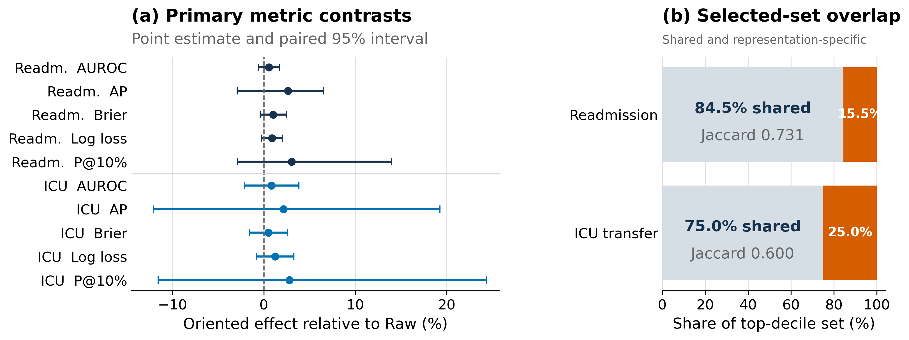

# Similar Scores, Different High-Risk Episodes: Auditing Model Selection in Longitudinal EHRs

**Polina Korobeinikova, Dmitry Lvov, Ilya Pershin**

Accepted poster at TAE (Trust-AI-Eval), NeurIPS 2026

[NeurIPS poster page](https://neurips.cc/virtual/2026/178289) | [Paper and reviews](https://openreview.net/forum?id=RffArnWpec)

[Main findings](#main-findings) | [Reproduce public results](#reproduce-public-results) | [Full experiments](#full-experiments) | [Repository map](#repository-map) | [Citation](#citation)

## Main Findings

Do similar prediction scores lead to the same high-risk selections? We compare
raw EHR histories with persistence-aware **Era+backfill** sequences on EHRSHOT
30-day readmission and ICU transfer, across 14 task-representation pairs and
five training seeds. The evaluation connects predictive performance with
calibration, retraining stability, fixed-capacity selection, and controlled
diagnosis repetition.

**Changing the history representation replaces 25% of each ICU top-risk list,
despite close aggregate prediction scores.**

| Held-out task | Episodes in each top-10% list | Shared | Specific to each list | Per-list replacement |
| --- | ---: | ---: | ---: | ---: |
| Readmission | 219 | 185 | 34 | 15.5% |
| ICU transfer | 204 | 153 | 51 | 25.0% |

These counts describe prediction episodes, not unique patients or a percentage
improvement in accuracy. Era+backfill leads all ten primary point estimates,
while every paired patient-cluster 95% interval includes zero. Retraining also
changes priority lists. Controlled diagnosis repetition favors different
representations in the two tasks, showing why model selection needs evidence
about selected episodes and behavior alongside aggregate scores.

<p align="center">
  
</p>

*Similar aggregate scores can coexist with different prioritized episodes.*

## Reproduce Public Results

Use Python 3.13 and run from the repository root. No EHR records, GPU,
credentials, or external services are needed.

```bash
python -m venv .venv
source .venv/bin/activate
python -m pip install -r requirements-public.txt
python paper/reproduce_public.py
```

On Windows PowerShell, use `.venv\Scripts\Activate.ps1` for activation.
This regenerates three figures and the tables from [public aggregates](paper/aggregate_outputs/),
not models or patient-level bootstrap intervals. The CSV field `auprc` denotes
**average precision (AP)**.

## Full Experiments

Use a separate Python 3.12 environment with `requirements.txt`.
The [experiment guide](docs/EXPERIMENTS.md) covers train-only whitelist
construction, sequence building, multiseed training, and repetition experiments.
Configure private data and output paths, use fresh caches for changed inputs,
and keep restricted inputs and outputs outside version control.

**EHRSHOT requires separate authorized access** under its Credentialed Health
Data License. Do not redistribute medical-data rows, patient identifiers,
row-level predictions, or checkpoints; keep restricted inputs and outputs
outside the public repository.

## Repository Map

| Path | Contents |
| --- | --- |
| [paper/aggregate_outputs](paper/aggregate_outputs/) | Published aggregate tables, with no patient-level records |
| [paper/reproduce_public.py](paper/reproduce_public.py) | Offline validation and regeneration of three figures |
| [paper/analysis](paper/analysis/) | Statistical analyses for authorized derived predictions |
| [final_exps](final_exps/) | Data preparation, training, component controls and repetition tests |
| [configs](configs/) | The final task, representation and training configurations |
| [docs/EXPERIMENTS.md](docs/EXPERIMENTS.md) | Input requirements and commands for the full workflow |
| [tests](tests/) | Aggregate arithmetic, package hygiene and pipeline-contract checks |

## Additional Analyses

With the authorized private reproducibility package, follow the
[analysis commands](docs/EXPERIMENTS.md) to recompute aggregate metrics,
calibration, selected-set comparisons, and strictly pre-prediction repetition
summaries. These analyses require restricted inputs; the public quick start
only redraws the published aggregate evidence.

## Citation

The [NeurIPS page](https://neurips.cc/virtual/2026/178289) lists the presentation;
the [OpenReview record](https://openreview.net/forum?id=RffArnWpec) contains the
paper and reviews. Use [CITATION.cff](CITATION.cff) for author and repository metadata.
See [LICENSING.md](LICENSING.md) for code reuse and third-party terms; no blanket
software license is currently assigned.

## Acknowledgments

All authors are affiliated with the Research Center of the Artificial Intelligence
Institute, Innopolis University, Innopolis, Russia. Dmitry Lvov is also affiliated
with ITMO University and Ilya Pershin with Kazan Federal University.
This study was supported by the Ministry of Economic Development of the Russian
Federation (agreement No. 139-10-2025-034 dated 19.06.2025,
IGK 000000C313925P4D0002).
